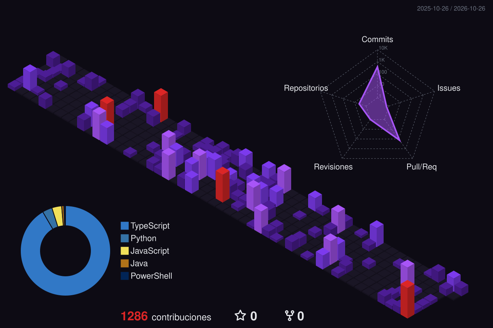

  

  

  

  

---

## ⚔️ Sobre mí

<!-- Edita estas líneas con tu información -->
- 🎓 **Universidad Piloto de Colombia**: laboratorio remoto, IoT y mi proyecto de grado
- 💼 En el trabajo construyo servicios backend con **C# / .NET** y **Python** para video, IoT y visión por computador
- 🔭 Ahora mismo: **LaboRemoto**, un laboratorio remoto hecho en Rust + Tauri
- ⚡ Mi regla: **cuando algo se rompe, no me rindo, lo arreglo**

Tengo tres caminos y un mismo objetivo: **superar mis límites**.

---

## 🛤️ Mis tres caminos

  

Datos, modelos y decisiones bien pensadas antes de escribir la primera línea.

| Proyecto | Qué hace | Stack |
|---|---|---|
| [**sp500-fair-value-model**](https://github.com/Haider2231/sp500-fair-value-model) | Estima el valor justo del S&P 500 con 4 metodologías y las valida con un backtest desde 1871 | Python · Streamlit |
| [**easyDiesel**](https://github.com/FelipeGo18/easyDiesel_kode) | Proyecto de grado (en equipo): trazabilidad del combustible y precio correcto según el Decreto 1428 de 2025 | React · Express · Prisma · PostgreSQL |

  

  
  

 

  

Lo que no se ve pero lo sostiene todo: conexiones remotas, hardware y sistemas en tiempo real.

| Proyecto | Qué hace | Stack |
|---|---|---|
| [**LaboRemoto**](https://github.com/LabRemotoUpiloto/LaboRemoto) | Cliente de escritorio para laboratorios remotos de la universidad: terminal SSH, SFTP, escritorio VNC, control de GPIO en Raspberry Pi, Arduino, cámaras WebRTC y un agente de IA | Rust · Tauri · React · TypeScript |
| **Peaje Free-Flow** 🔒 | Peaje sin barreras (en equipo): detección de placas con YOLO en Jetson, lectura RFID UHF, AWS IoT por MQTT y backend .NET con SignalR | C# · .NET · Python · React |
| [**windowsSSH-3.0**](https://github.com/Haider2231/windowsSSH-3.0) · [**Releases-Cliente-SSH**](https://github.com/Haider2231/Releases-Cliente-SSH-Unipiloto) | Cliente SSH para Windows y su flujo de releases | Python · PowerShell |

  

  
  

 

  

Productos hechos desde cero y laboratorios donde aprendo a golpes.

| Proyecto | Qué hace | Stack |
|---|---|---|
| **Pet Shop Gachancipá** 🔒 | Tienda en línea para una pet shop local: catálogo, carrito y pedidos a domicilio | React · Supabase · Tailwind |
| **Blusas E-commerce** 🔒 · **Music Stats** 🔒 | Catálogo de tienda y estadísticas de música | TypeScript · React |
| [**Chat**](https://github.com/Haider2231/Chat) · [**Server-Socket**](https://github.com/Haider2231/Server-Socket) | Chat y servidor por sockets, mis primeros pasos en redes | Java |
| [**Laboratorio-signup-login**](https://github.com/Haider2231/Laboratorio-signup-login) · [**prueba_reserva**](https://github.com/Haider2231/prueba_reserva) | Laboratorios de autenticación y reservas | Java · JavaScript |

  

  
  

---

## 🔥 Progreso del entrenamiento

  
  

  

  

## 🏙️ Mi ciudad de contribuciones

  

## 🐍 Las sombras devoran mis contribuciones

  <picture>
    <source media="(prefers-color-scheme: dark)" srcset="https://raw.githubusercontent.com/Haider2231/Haider2231/output/github-snake-dark.svg" />
    <source media="(prefers-color-scheme: light)" srcset="https://raw.githubusercontent.com/Haider2231/Haider2231/output/github-snake.svg" />
    
  </picture>

  

